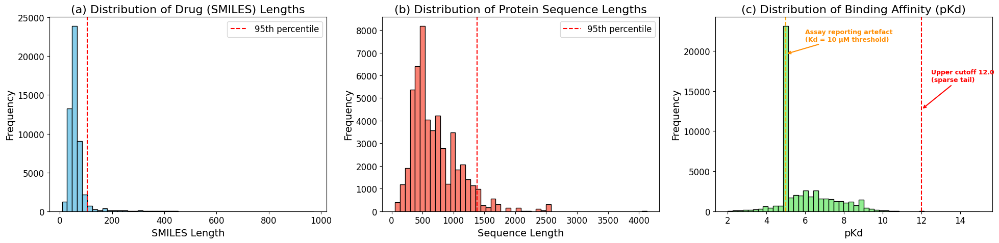
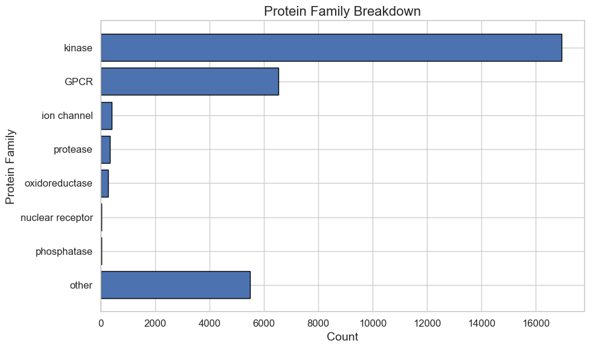
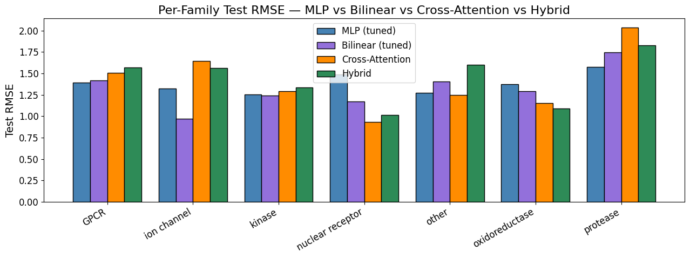

# Drug Protein Affinity

Predicting how strongly a small-molecule drug binds to a protein target (**pKd**) using frozen,
pre-trained transformer embeddings — [ProtBERT-BFD](https://huggingface.co/Rostlab/prot_bert_bfd)
for protein sequences and [ChemBERTa](https://huggingface.co/DeepChem/ChemBERTa-100M-MLM) for
drug SMILES — with four lightweight fusion heads trained on top.

> Team project for Harvard **AC 209b (Advanced Topics in Data Science)**, Spring 2026.
> 📓 [Full analysis notebook](notebooks/drug_protein_affinity.ipynb) · 📄 [Final paper (PDF)](docs/final_paper.pdf)

## Highlights

- **Result:** test RMSE of **1.30 pKd on proteins never seen in training**, 12% below a
  mean-prediction baseline, from 30k cleaned BindingDB measurements.
- **Four fusion architectures compared on the same split and features:** MLP, bilinear,
  bidirectional cross-attention, and a two-pathway hybrid, each built in PyTorch and tuned.
  The simplest won, which points to the frozen encoders, not the fusion head, as the bottleneck.
- **Rigorous data work:** found and removed an assay artefact affecting ~40% of records,
  measured inter-lab label noise to set a realistic error floor, and used a protein-level,
  family-stratified split to prevent leakage.
- **Tuning at scale:** an automated ~109-run search, Optuna (TPE + median pruning), and targeted
  regularisers including Mixup, modality dropout, stochastic attention-layer dropout, and pathway dropout.
- **Stack:** PyTorch · Hugging Face Transformers (ProtBERT, ChemBERTa) · Optuna · scikit-learn ·
  pandas · TDC · UniProt REST API · pytest

## Motivation

Bringing a drug candidate to clinic can take over a decade and cost billions, and wet-lab
screening is a major bottleneck. If binding affinity can be predicted from sequence alone,
candidates can be **triaged computationally** so that expensive experiments focus on the
most promising leads. This project asks two questions:

1. Can frozen pre-trained embeddings plus a small fusion head predict pKd well enough to support triage?
2. Does the **fusion architecture** (MLP, bilinear, cross-attention, or a hybrid) matter once each is tuned?

## Approach

```
 Drug SMILES ──► ChemBERTa (frozen) ──► 768-d CLS / token embeddings ──┐
                                                                       ├──► fusion head ──► pKd
 Protein seq ──► ProtBERT  (frozen) ──► 1024-d CLS / token embeddings ─┘
```

**Data.** [BindingDB Kd](https://tdcommons.ai/multi_pred_tasks/dti/) from Therapeutics Data
Commons: 52k (drug, protein, Kd) measurements, ~1.4k proteins and ~10.7k drugs. Proteins were
labelled with families (kinase, GPCR, protease, …) by querying the UniProt REST API.

**Key EDA findings that shaped preprocessing:**



- **Assay artefact.** Roughly 40% of records sit at exactly pKd = 5.0 (Kd = 10 µM), a common
  screening cutoff that really means "≤ 5". These were dropped, along with a sparse tail above pKd 12.
- **Inter-lab noise.** Repeated (drug, protein) measurements have a median SD of ~0.44 pKd,
  which puts a floor on achievable error. All replicates were kept rather than averaged.
- **Heavy imbalance.** Kinases and GPCRs dominate, and a few "hub" proteins have hundreds
  of binders while most have fewer than five.

<p align="center"></p>

**Leakage-safe split.** A 70/15/15 split **by protein**, stratified by family, so every test
protein is unseen during training. That is harder and more realistic than a random pair-level
split. Training uses inverse-sqrt per-protein sampling to counter hub-protein dominance.

## Fusion heads

All heads sit on top of frozen, cached embeddings and are trained with MSE loss and a
protein-balanced sampler. Code: [`src/affinity/models.py`](src/affinity/models.py).

| Head | Input | Params | Fusion | Key tuning |
|---|---|---:|---|---|
| **MLP** | CLS vectors | 2.5 M | Concatenation | Mixup, modality dropout |
| **Bilinear** | CLS vectors | 17.2 M | Feature × feature products | LayerNorm, dropout 0.4 |
| **Cross-attention** | Token sequences | 0.4 M | Drug ↔ protein attention | Attention-layer dropout |
| **Hybrid** | Token sequences | 1.0 M | Cross-attention + bilinear | Pathway dropout |

## Results

RMSE in pKd units (lower is better). Validation and test proteins are never seen during training.
An RMSE of 1.30 means predictions are typically within a factor of ~20 of the measured Kd.

| Model | Train | Val | Test |
|---|---:|---:|---:|
| Naive (predict training mean) | 1.536 | 1.563 | 1.485 |
| **MLP (tuned)** | 0.779 | 1.253 | **1.303** |
| Bilinear (tuned) | 1.296 | 1.402 | 1.322 |
| Cross-attention (tuned) | 0.983 | 1.350 | 1.355 |
| Hybrid (tuned) | 1.102 | 1.325 | 1.453 |



**Takeaways**

- **Simpler was better.** The tuned MLP beat every more expressive head. All four cluster
  between 1.30 and 1.45 despite very different inductive biases.
- **Regularisation, not capacity, was the bottleneck.** Most of the gains in every search came
  from regularisation (modality dropout, Mixup, LayerNorm, attention and pathway dropout, small
  batches), not from bigger models.
- **The encoders limit the ceiling.** Frozen ProtBERT and ChemBERTa were never trained on a
  binding objective, and 1-D sequence embeddings miss 3-D binding geometry. The best model
  sits ~2–3× above the inter-lab noise floor.

**Future directions:** parameter-efficient fine-tuning of the encoders (LoRA/adapters),
structural features from AlphaFold, applying the winning regularisers across all heads, and a
more protein-diverse training corpus.

## Repository structure

```
├── notebooks/
│   └── drug_protein_affinity.ipynb   # End-to-end report: EDA → preprocessing → embeddings → models → results
├── src/affinity/
│   ├── models.py                     # MLP, bilinear, cross-attention, and hybrid fusion heads
│   └── data.py                       # Dataset, padding collate, protein-balanced sampler
├── tests/test_models.py              # Shape, masking, and sampler tests
├── figures/                          # Figures used in this README
└── docs/final_paper.pdf              # Final project write-up
```

The notebook is the executed record of the project and defines everything inline. `src/affinity`
packages the same model and data code as an importable library. Its classes load the
notebook's trained checkpoints directly.

## Running it

```bash
pip install -e ".[notebook,dev]"
pytest                                   # quick checks, CPU only
jupyter lab notebooks/drug_protein_affinity.ipynb
```

The notebook downloads BindingDB from TDC on first run and writes `data/` (splits and cached
embeddings) and `checkpoints/` next to itself. Neither is committed: the token-level embedding
caches alone are about 5 GB. Encoding proteins with ProtBERT and training the token-level
models needs a GPU (the project used Google Colab). When checkpoints are present, training cells
load them instead of retraining.

## Team

Andrew Jing · Awassada Ariyaphuttarat · Hoi Cheung · Sammy Mohamed
